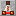
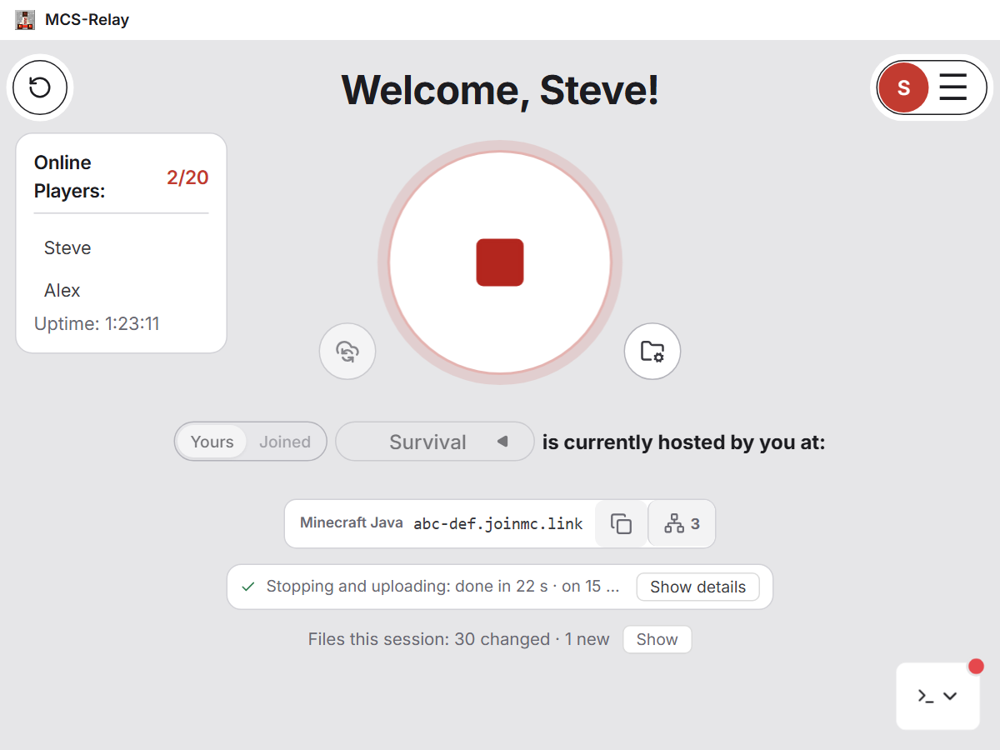
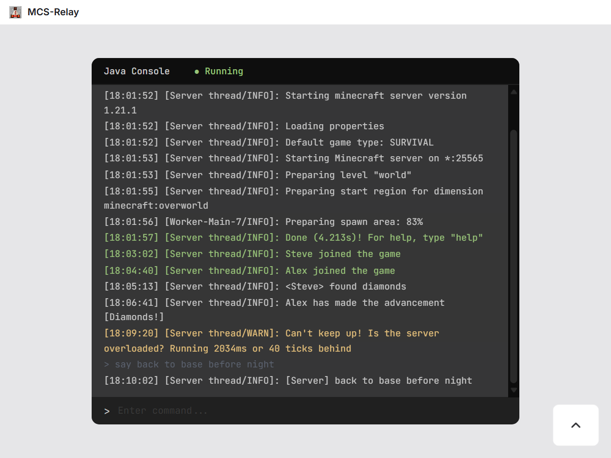

<p align="center">
  
</p>

<h1 align="center">MCS-Relay</h1>

<p align="center">
  Host your Minecraft server together, from a shared Google Drive.<br>
  Whoever wants to play hosts it; the world is saved for the next one.
</p>

<p align="center">
  <a href="https://github.com/yeet30/MCS-Relay/releases/latest"></a>
  <a href="LICENSE"></a>
  
</p>

<p align="center">
  <a href="https://mcs-relay.com/">Website</a> ·
  <a href="https://github.com/yeet30/MCS-Relay/releases/latest">Download</a> ·
  <a href="https://mcs-relay.com/privacy.html">Privacy policy</a> ·
  <a href="https://mcs-relay.com/terms.html">Terms of use</a>
</p>

<p align="center">
  
  
</p>

## Why

A group of friends with one Minecraft world usually needs one of two things: a rented server, or the one friend
whose PC runs the server being online whenever anyone wants to play. MCS-Relay removes both. The world lives in a
Google Drive folder that you all share, and whoever wants to play hosts it on their own PC:

1. **Start**: MCS-Relay reserves the server for you, downloads what changed since you last played, and starts the
   Minecraft server (and playit.gg, if you use it, so friends can join from anywhere).
2. **Play**: your friends join with the address MCS-Relay shows you.
3. **Stop**: the world is uploaded, only the files that changed, and the server is free for the next person.

## Features

- **Take turns hosting**: anyone in the group can host; the world always continues from where the last host stopped.
- **One host at a time**: a server is reserved while someone uses it, so two people never run it at once and
  overwrite each other's world.
- **Only changes are transferred**: after the first upload, a session moves just the files that changed, several
  at a time.
- **Safe uploads**: an upload becomes the new version only when every file has arrived. You can pause it, continue it
  later (also after a crash or a closed laptop), or cancel it.
- **Conflicts are shown, never guessed**: if your copy and the cloud both changed, you choose which one to keep.
- **playit.gg built in**: every tunnel of your playit.gg agent (Minecraft Java, Bedrock, Simple Voice Chat, web
  maps) is shown with what it is for, for you and for everyone in the group.
- **Server management**: invite and remove members, choose which files are left out of the sync, sync without
  playing, and repair a server whose upload was interrupted.
- **Download a server**: pick vanilla, Paper or Fabric and a version; the app downloads it from the official source
  (Mojang, PaperMC, FabricMC), checks it, and tells you which Java it needs.
- **World backups**: name a backup, keep it on your PC or put it in the cloud for everyone, and restore any of them;
  the current world is backed up first. While you host, the server pauses saving for a moment.
- **Lives in the tray**: notifications and a sound when a start or stop finishes or fails, Light / Mint / Dark themes,
  and automatic updates.
- **Problem reports**: Settings → Report a problem sends your description and the app's log to the developer
  through your own Google Drive, or saves them as a file.

## Getting started

You need Windows 10 or 11, a Google account, and [Java](https://adoptium.net/) in the version your Minecraft server
needs.

1. Download `MCS-Relay-Setup-<version>.exe` from the [latest release](https://github.com/yeet30/MCS-Relay/releases/latest)
   and run it. Windows may say it "protected your PC", because the installer is not signed yet: choose
   **More info → Run anyway**.
2. Sign in with Google. MCS-Relay asks for access to your Google Drive, because it has to read the world files your
   friends upload; it only works in its own server folders (see [Your data](#your-data)). Then read and agree to
   the [terms of use](#play-with-people-you-trust).
3. **Create a server**, give it a name, and choose its folder on your PC: the folder the Minecraft server runs from,
   with the server `.jar` (for Forge and NeoForge: the folder their installer set up with "Install server"). An
   existing server folder works too. MCS-Relay finds what starts the server by itself; it does not need a `run.bat`.
4. **Invite your friends** from Settings → Drive Folders. Google Drive emails them a link; they paste it into
   **Join a server** in their own MCS-Relay.
5. Press the power button.

To let friends join from anywhere without port forwarding, install [playit.gg](https://playit.gg), set up a
Minecraft Java tunnel once, and turn it on in Settings → Scripts.

## Your data

MCS-Relay has no servers of its own. It talks to Google Drive straight from your PC, keeps your sign-in encrypted on
it, and works only inside the "Minecraft Shared Servers" folder it creates and the servers you join (and a "MCS-Relay
problem reports" folder, when you send a report). Nothing is sold, shared for advertising or collected for statistics. The [privacy policy](https://mcs-relay.com/privacy.html)
lists exactly what is used and stored, and how to remove it.

If Google shows **"Google hasn't verified this app"** when you sign in, the app has not finished Google's review for
apps with full Drive access yet. Choose **Advanced → Go to MCS-Relay** to continue.

## Play with people you trust

When you host, the server's files run on your PC: the server `.jar`, its mods and its plugins are programs, with the
same access to your PC as anything else you run. Every member who can play can change those files, and MCS-Relay does
not scan them. Someone with bad intentions, or whose Google account was taken over, could hide harmful software in a
server, and it would run on the PC of whoever hosts next.

- Create, join and invite only with people you trust. "Can view" members cannot change files.
- Keep your antivirus on.
- If mods, plugins or programs appear that nobody mentioned, ask before you host.

The app asks every Google account to agree to this, in the [terms of use](https://mcs-relay.com/terms.html), before it
can be used.

## Building from source

You need [Node.js](https://nodejs.org/) 22 and a Google Cloud project of your own:

1. In the [Google Cloud console](https://console.cloud.google.com/), create a project, enable the **Google Drive
   API**, and set up the **Google Auth Platform** (External) with the scopes `openid`,
   `.../auth/userinfo.email`, `.../auth/userinfo.profile` and `.../auth/drive`. While it is in Testing, add your
   Google account as a test user.
2. Create an **OAuth client ID** of type **Desktop app**, download its JSON and save it as `config/client_secret.json`
   (the `config` folder is not committed). The build puts it into the app; a build without it cannot sign in.
3. Then:

```bash
npm ci
```

```bash
npm run dev
```

| Command | What it does |
|---|---|
| `npm run dev` | Runs the app with hot reload. |
| `npm test` | Runs the tests (Vitest; Google Drive is faked, nothing touches a real account). |
| `npm run lint` / `npm run typecheck` | ESLint and TypeScript checks. |
| `npm run build` | Builds the Windows installer into `release/` without publishing it. |

### How the code is organised

| Folder | What is in it |
|---|---|
| `electron/` | The main process: Google sign-in, the Drive client, the server reservation (`lock/`), syncing and transfers, the Minecraft and playit.gg processes, the session that ties them together, and app updates. |
| `src/` | The window: React components and zustand stores. |
| `shared/` | Types and the IPC contract between the two. |
| `website/` | The website, published to GitHub Pages. |
| `docs/` | Design notes, among them [the specification of the rewrite](docs/rewrite/SPEC.md). |

### Releasing

Set the new `version` in `package.json`, commit it, then push a matching tag:

```bash
git tag v1.0.1
```

```bash
git push origin v1.0.1
```

GitHub Actions checks, tests and builds the installer and publishes it as a release; installed apps update
themselves from it. The workflow needs one repository secret, `GOOGLE_CLIENT_SECRET_JSON`, holding the contents of
`config/client_secret.json`.

## License

[MIT](LICENSE). Not an official Minecraft product. Not approved by or associated with Mojang or Microsoft. Google
Drive is a trademark of Google LLC.
